  

  
  
  
  

  
  
  
  

I build AI systems that do real work and can be trusted with it: agents that operate desktop
software through the Model Context Protocol, and document pipelines on Azure that only report
what they can point to. Everything ships with tests, CI and evaluation, the way a team would
build it.

## Featured: Azure AI engineering

<table>
<tr>
<td width="50%" valign="top">

### [Revisa](https://github.com/xDarkzx/Revisa)
**Document AI on Azure.** Reads construction-drawing title blocks into a drawing register.

- Azure Document Intelligence OCR, then a gpt-4.1-mini reader that may only cite text the OCR found
- Review routing with reasons, and a register in Cosmos DB
- Measured on 200 labelled drawings, reported on a held-out half
- Deployed with Bicep and managed identity, run once, then torn down, with the [evidence committed](https://github.com/xDarkzx/Revisa/tree/main/docs/azure-proof)

</td>
<td width="50%" valign="top">

### [Escalon](https://github.com/xDarkzx/Escalon)
**Grounded IT-support agent.** Built on Microsoft Agent Framework.

- Hybrid search over Microsoft support docs
- MCP tools exposed to Copilot Studio
- Entra ID authentication and ticketing integration
- Evaluation suite for answer quality

</td>
</tr>
</table>

## Featured: robotics and AI vision

### [Companion](https://github.com/xDarkzx/Companion)
**A ROS 2 robot brain that finds what you ask for.** Ask "where is the mug?" and it answers in metres.

- Open-vocabulary detection (OWLv2, Grounding DINO) plus depth, placing objects in 3D for a voice agent on ROS 2 Jazzy with Nav2
- Measured on public data: 43.6 AP on COCO, and a 5.4 cm median 3D error on NYU Depth V2 with a depth camera
- Typed topic and service contracts checked in CI, launch tests of the full voice-to-answer path, and a one-command Docker gate

## MCP servers used in the wild

| Project | Stars | What it does |
|---|---|---|
| **[Audacity-MCP](https://github.com/xDarkzx/Audacity-MCP)** |  | 144 tools and 9 end-to-end pipelines for AI-driven audio editing: cleanup, effects, mastering, transcription, podcasts. |
| **[Reaper-MCP](https://github.com/xDarkzx/Reaper-MCP)** |  | 181 tools for music production in REAPER: composition, mixing, mastering, batch editing and ReaScript automation. |
| **[OBS-MCP](https://github.com/xDarkzx/OBS_MCP)** |  | 148 tools over obs-websocket: scenes, audio, filters, streaming, recording and stream-health diagnostics. |
| **[FMOD Studio MCP](https://github.com/xDarkzx/Dans_Fmod_Studio_MCP)** |  | Game-audio authoring through FMOD's scripting terminal: events, parameters, mixer, banks, interactive music. |
| **[SongForge-MCP](https://github.com/xDarkzx/SongForge-MCP)** |  | Local AI music generation (ACE-Step) with stem splitting and reference-style matching, driven from Claude Desktop. |

### See it in action

| Audacity-MCP | Reaper-MCP |
|:---:|:---:|
|  |  |

## Tech stack

  
  
  
  
  
  
  
  
  
  
  
  
  
  

## How I build

- **Grounded, not guessed.** Model output has to point at its evidence; MCP tools are checked against each application's real protocol and source.
- **Measured.** Labelled evaluation sets, held-out results, and numbers reported as they are.
- **Production hygiene.** Protected branches, pull requests, CI with lint, types, tests and security scanning, changelogs and ADRs.
- **Maintained in public.** Issues triaged, outside pull requests reviewed and merged, releases documented.

## Also built

- **[GigChain-Keys](https://github.com/xDarkzx/GigChain-Keys)**: a C++ live-performance rig for keyboard players, with VST3 hosting, setlists, chord charts and a stage-ready Perform mode.
- **[The Last Bastion](https://github.com/xDarkzx/TheLastBastion)**: trust infrastructure for autonomous AI agents, with Ed25519 challenge-response identity, signed agent passports and tamper-evident audit trails.

  <picture>
    <source media="(prefers-color-scheme: dark)" srcset="https://raw.githubusercontent.com/xDarkzx/xDarkzx/output/github-contribution-grid-snake-dark.svg">
    
  </picture>

<b>Hiring for AI engineering in New Zealand or remote?</b> <a href="mailto:dkstudiosnz@gmail.com">Get in touch</a>. I also take contract work building MCP servers and AI integrations.

